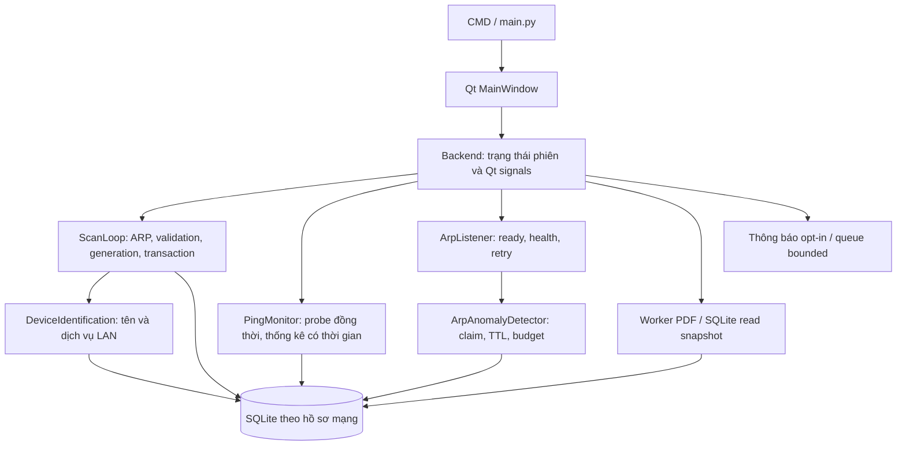

# Kiến trúc hiện tại - 12/11/2026

`core/`, `services/`, `db/` không import Qt. Backend chuyển callback thành signals; UI dựng widget và gọi API backend. Các thao tác có I/O dài chạy trên worker. Data/ping/diagnosis/hop có hợp đồng dữ liệu rõ; ping/diagnosis/hop bất biến. Snapshot phép đo là bản copy có generation.

## Ngữ cảnh dữ liệu

Network List Manager cung cấp profile GUID theo adapter GUID. Network ID kết hợp profile, card ổn định, subnet/gateway và nhãn bổ sung. MAC riêng tư của chính card không là khóa ổn định của hồ sơ. `network_scope` dùng ContextVar để worker giữ scope ban đầu, không đổi DB theo một biến global mutable giữa chừng.

Mỗi network có file SQLite riêng dưới `data/networks`; DB gốc là legacy chưa có định danh mạng. Session lưu metadata card và thời gian có quan sát. Ping có địa chỉ đích, session, status và timestamp; observations tách IP-MAC khỏi hồ sơ một thiết bị. Trust/baseline/identity đều thuộc cùng scope lưu trữ.

## Scan, callbacks và dừng

Scan xác nhận capture sẵn sàng, kiểm tra các lỗi nền/cleanup và giữ đầy đủ IP-MAC claim. Đọc lại kết nối/generation trước transaction; khóa commit chung với backend ngăn đổi phiên giữa bước kiểm tra và cập nhật. Scan lỗi/hủy không tăng misses; quét một dải nhỏ không đếm vắng địa chỉ ngoài dải.

`IPv4Hosts` là Sequence tính lười với kích thước/truy cập/slice không liệt kê subnet. `ScanResult` giữ tập IP đã gửi, tổng số host và vị trí phần tiếp theo. ScanLoop chỉ tiến cursor sau commit thành công, đặt lại khi đổi kết nối; mỗi phần tối đa 1.024 host cộng gateway, packet được dựng theo lô 64. Phần kế tiếp của mạng lớn chạy sau 1 giây; hết vòng mới dùng chu kỳ quét thông thường. UI có tiến độ theo generation và bảng phân trang 250 dòng; dữ liệu/tổng thống kê không bị cắt ở 250 thiết bị.

Upsert, hiện diện, nhận diện cơ bản và quyết định cảnh báo nằm trong transaction nghiệp vụ. Callback chạy sau commit và được cô lập lỗi; UI coalesce cập nhật. Các signal kết nối/chẩn đoán/phép đo trễ được so với trạng thái mới nhất. Signal cảnh báo có provenance mạng.

Stop giữ handle đến khi join xong; timeout ném lỗi và giữ tài nguyên. Backend chỉ đóng SQLite sau khi worker đã dừng. Khóa process ngăn hai tiến trình giám sát cùng bộ dữ liệu. Native driver treo vĩnh viễn vẫn là giới hạn của tiến trình Python.

## Lịch sử và báo cáo

Writer dùng transaction có khóa và savepoint lồng nhau. Báo cáo đọc snapshot bằng connection riêng trong WAL để không giữ khóa UI/writer. Truy vấn có giới hạn và hai cận thời gian; PDF tổng hợp timeout, tách lỗi đo/thiếu dữ liệu, lấy metadata phiên cũ và ghi nguyên tử sau thành công. Restore dùng SQLite backup sau khi dừng worker và có khóa process.

Schema có version/migration và snapshot trước nâng cấp CSDL có dữ liệu. Retention được chạy theo hồ sơ đang theo dõi; giữ metadata người dùng và trạng thái biên. Logs, DB/sidecar/backup, token, cache và build output không thuộc source commit mới.

Chi tiết từng sửa đổi và giới hạn nghiệm thu: [báo cáo sửa mã](remediation-report-2026-11-12.md).
